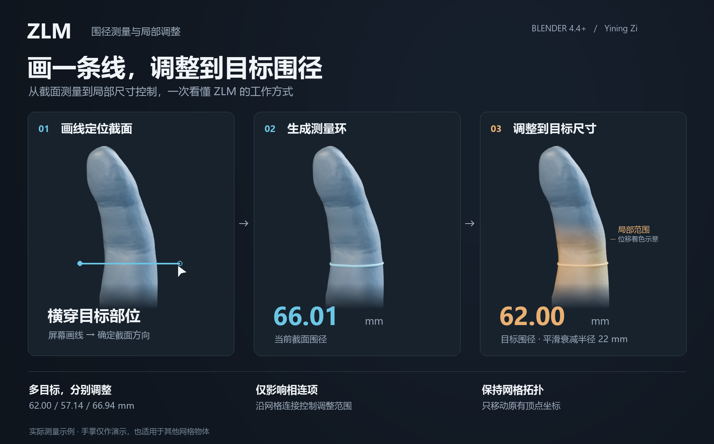

# ZLM · 围径测量与局部调整

在 Blender 中画一条线，测量模型的截面围径，再通过目标周长和衰减参数调整局部尺寸。**只移动原有顶点，不增删顶点、边、面，不改变连接关系。**

作者：**Yining Zi** · 当前版本：**1.11.1** · 最低 Blender：**4.4.0**

展示图采用实际测量与调整前后的模型：围径由 **66.01 mm** 调整为 **62.00 mm**，衰减半径为 **22 mm**。暖色是顶点位移的展示着色，用于说明局部影响范围。手指仅作示例；其他能够形成有效截面的网格物体也可使用。

## 下载和安装

1. 打开 [最新版本](https://github.com/YiningZi/ZLM/releases/latest)，下载 `ZLM-1.11.1.zip`（后续版本文件名随版本变化）。
2. Blender → 编辑 → 偏好设置 → 插件 → 右上角菜单 → **从磁盘安装**，选择 ZIP 并启用 ZLM。
3. 更新后重启 Blender，选中网格，在三维视图按 `N`，打开 **ZLM** 标签。

请下载 Release 中的插件 ZIP；GitHub 自动提供的 `Source code` ZIP 是开发源码，不能直接当作扩展安装。发布附件同时提供 `SHA256SUMS.txt`。

## 快速上手

1. 确认模型真实比例与场景单位，切换到物体模式。
2. 点击 **新增测量目标**，横穿目标部位画线，让线段中点落在该部位表面。右键或 Esc 取消。
3. 转动视角检查截面环与读数。这里测量的是环线周长，不是直径。
4. 在列表中选中目标，输入 **目标周长**，例如 `62 mm`。
5. 设置 **衰减半径**、衰减类型，按需保留 **仅影响相连项** 和 **锁定截面法线**。
6. 点击 **调整当前目标**，复核形状及更新后的围径；需要时用 `Ctrl+Z` 撤销。

## 主要功能

- 正交、透视视图均可画线定位截面，按命中位置选择环线。
- 多目标测量：独立名称、目标围径和衰减设置；调整后刷新同一模型上的其他读数。
- 高面数网格使用真实剖切拓扑提取有序环线，避免按距离拼点导致错误跨接。
- 支持未封口片体；断开的截面以端点间直线补齐，并计入周长。
- 相连衰减沿网格边传播；关闭时使用空间距离衰减。
- 调整失败或围径误差超过 0.1% 时，取消并恢复坐标。
- 安装包 SHA-256 完整性检查，异常时提示，不锁定场景。

## 使用边界

**邻指保护取决于半径。** 手指通常通过掌部相连，半径过大时，衰减仍可能沿掌部传播到邻指。建议在指缝已分离的位置画线，并使用局部半径；半径 `0` 表示自动估算。

**截面方向会影响周长。** 画线斜度、模型单位和比例都会影响读数；只切换单位显示不会校准模型真实大小。补齐缺口的周长包含直线段，需要检查是否符合实际用途。

**修改器存在限制。** 若修改器结果不能对应到可编辑原始网格，相连衰减会提示失败并恢复。多个目标的影响范围可能重叠，调整后应一起核对。

完整操作、更新和故障排查见 [使用指南](docs/USAGE.md)。

## 兼容性与验证

| Blender | 状态 |
| --- | --- |
| 4.4.3 | 本地回归验证；GitHub Actions 自动测试目标 |
| 5.1.1 | 既有开发记录已验证；当前 CI 不覆盖 |
| 5.2 | 已通过测试，作者于 2026-10-12 确认；当前 CI 不覆盖 |
| 4.5、5.0 等 | 清单允许安装，尚未逐一验证当前版本 |

测试覆盖高面数闭环、开放片体、单指选环、多目标更新、相连/空间衰减、非均匀缩放、内部壳层隔离、失败回滚、拓扑保持、单位显示、扩展加载和完整性告警。

## 版本、修改和维护

- [版本更新记录](CHANGELOG.md)：从本地保留的最早版本 **1.10.0** 开始，只发布实际保留的版本。
- [贡献与修改指南](CONTRIBUTING.md)：开发、测试、提交修改的方法。
- [维护与发布流程](docs/MAINTENANCE.md)：版本号管理、CI 和 Release 发布。
- [反馈问题](https://github.com/YiningZi/ZLM/issues/new/choose)：提供 Blender 版本、插件版本、复现步骤和报错。

源码入口保留历史名称 `bflm_loop_measure.py`；构建时转换为扩展入口 `__init__.py`。内部 `bflm.*` 操作 ID 继续保留，避免影响既有引用。

## 许可证

Copyright © 2026 Yining Zi. **GPL-3.0-or-later**，见 [LICENSE](LICENSE)。

允许按许可证修改与再分发；修改后请重新构建安装包和完整性清单。SHA-256 清单用于发现文件变化，不是数字签名，也不代表不可绕过的防篡改保护。
